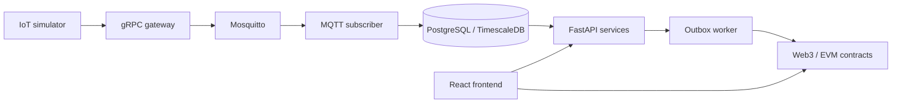

# Backend architecture

Telemetry follows `simulator -> gRPC gateway -> MQTT -> subscriber -> PostgreSQL/TimescaleDB`. The subscriber validates the envelope, deduplicates `(device_id, sequence_number)`, stores the original payload, and writes one typed reading table.

The FastAPI API is versioned at `/api/v1`. Routes authorize the principal and delegate business rules to services. Services use repositories for SQLAlchemy access and integrations for Web3 operations. The frontend consumes HTTP and wallet JSON-RPC; it never receives backend private keys.

Energy processing reads measured grid export as the eligibility basis. Intervals retain calculation versions and source telemetry links. Credit approval creates an outbox event; a durable worker submits the blockchain transaction and records confirmation separately.

